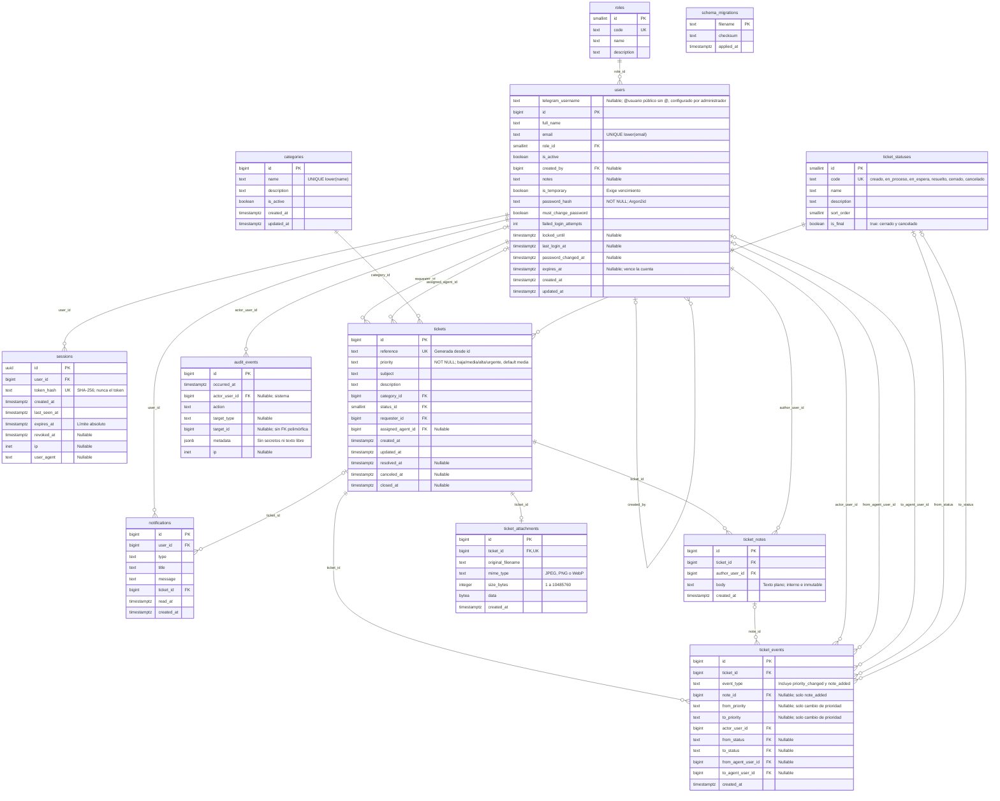

# Base de datos de HelpDesk

Esquema de HelpDesk, PostgreSQL 17 y migraciones SQL sin ORM.
Los archivos en `migrations/` y `seeds/dev.sql` forman parte del repositorio;
el volumen del contenedor conserva los datos locales de cada desarrollador.

## Reconstruir el entorno

Desde `backend/`, con Node 22, npm y Podman Compose:

```bash
npm ci
cp -n .env.example .env
# Si acabas de crear .env, completa DATABASE_URL con las credenciales POSTGRES_*.
npm run db:up
npm run db:migrate
npm run db:status
```

`db:up` usa `podman compose up -d postgres`, identifica el contenedor mediante
Compose y consulta su healthcheck durante un máximo de 90 segundos. Devuelve
código 0 solo si llega a `healthy`; falla si Compose falla, el contenedor se
detiene, queda `unhealthy` o vence el plazo. Evita `--wait`: en podman-compose
1.6.0 ese flag delega en `podman wait`, que puede imprimir `-1` aun terminando
correctamente con código 0.

Los comandos SQL leen `DATABASE_URL` de las variables del proceso o del `.env`
del backend. No necesitan `psql` en el sistema. Los archivos SQL también se
encuentran al ejecutar la herramienta compilada: `node dist/db/cli.js migrate`.
Conserva la carpeta `db/` junto a `dist/` al distribuir el backend.

## Crear y aplicar una migración

```bash
npm run db:new -- agregar_campo
# Edita el archivo recién creado antes de aplicarlo; su número depende de los existentes.
npm run db:migrate
npm run db:status
```

`db:new` funciona sin conexión ni `.env`; usa el siguiente número disponible
de cuatro dígitos y normaliza el nombre a snake_case sin acentos.
Los archivos se ejecutan en orden alfabético y no pueden repetir su número.
Coordina la numeración con el equipo al combinar ramas.

- Una migración aplicada es **inmutable**: nunca la edites, renombres ni borres.
  Los cambios posteriores van en otro archivo numerado.
- `public.schema_migrations` registra nombre, SHA-256 de los bytes originales
  y fecha de aplicación. Un checksum distinto o un archivo aplicado ausente
  hacen fallar tanto `db:migrate` como `db:status` antes de aplicar cambios.
- Cada archivo y su registro se confirman en una misma transacción. Si falla,
  esa migración se revierte y la ejecución se detiene; las anteriores permanecen.
- No incluyas `BEGIN`, `COMMIT`, `ROLLBACK` ni operaciones incompatibles con
  transacciones, como `CREATE INDEX CONCURRENTLY`. El ejecutor controla la transacción.
- Un advisory lock de sesión compartido por migrate, status, reset y seed evita
  que estas herramientas se ejecuten simultáneamente contra la misma base.
- No modifiques manualmente `schema_migrations` para eludir una discrepancia.
  Restaura el archivo original desde Git y crea una migración nueva.
- Los compañeros pueden ajustar `core.autocrlf=false` en su copia de Git para
  conservar los finales de línea de los SQL: el checksum incluye esos bytes.

## Reset y datos de ejemplo

```bash
# DESTRUCTIVO: elimina todos los objetos y datos del esquema public local.
npm run db:reset
npm run db:seed:dev
# Repetir el seed no duplica los ejemplos.
npm run db:seed:dev
```

Ambos comandos se niegan a operar salvo con `NODE_ENV=development` (el valor
predeterminado) y host `localhost` o `127.0.0.1` en `DATABASE_URL`. Tampoco
admiten parámetros de URL que redirijan el host. No operan en producción ni
con `NODE_ENV=test`.

`db:reset` recrea `public` dentro de una transacción y después aplica las
migraciones, cada una en su propia transacción. No carga ejemplos; si una
migración falla después del reset, la base queda con las anteriores aplicadas.
La operación afecta a toda la base configurada: úsala solo en la base local
dedicada a HelpDesk. No borra el volumen ni otras bases del contenedor.

El seed es una transacción: inserta cuatro empleados y una cuenta temporal `@helpdesk.local`, cinco
categorías y siete tickets: uno por estado y otro Creado ya asignado. Usa `ON CONFLICT DO NOTHING`; para tickets
también comprueba asunto y solicitante antes de insertar, sin introducir una
restricción artificial sobre los asuntos de tickets reales. Los ejemplos
existentes no se sobrescriben. Las secuencias pueden tener saltos al repetir
inserciones con conflicto; las referencias no pretenden ser consecutivas.

Antes del SQL, el seed calcula un hash Argon2id y lo pasa como parámetro
a un ajuste limitado a esa transacción. Las cuentas se insertan con hash
obligatorio y `must_change_password = false`. Usa
`SEED_DEV_PASSWORD` o, si está vacía, genera una contraseña aleatoria local en
`.seed-dev-password` (permisos 600, excluido de Git). No imprime ese valor ni
restablece contraseñas existentes. Consulta [la guía de autenticación](../docs/auth.md).

## Decisiones del esquema

- `users` y `tickets` usan IDs bigint identity; los catálogos fijos `roles` y
  `ticket_statuses` usan smallint. `categories` usa bigint porque es configurable.
- Cada usuario tiene exactamente un `role_id` obligatorio. No hay `user_roles`.
  Los correos y nombres de categorías son únicos con índices
  sobre `lower(...)`, sin extensiones.
- `0007_auth_sessions.sql` añade el hash de contraseña y los campos de acceso
  a `users`. `0010` exige un `password_hash` no nulo; `expires_at` nulo
  indica una cuenta sin vencimiento. Las sesiones guardan únicamente el SHA-256
  del token opaco, con límite absoluto, última actividad y revocación. La cuenta
  activa y su vencimiento se comprueban en cada petición autenticada.
- `0008_user_management.sql` agrega creador, notas e `is_temporary`.
  `0010_local_accounts_only.sql` exige hash Argon2id para todas las cuentas y
  conserva el vencimiento obligatorio de las cuentas temporales. Una instalación
  vacía permite crear su primer administrador mediante seed o la CLI.
- `0011_ticket_core.sql` incorpora límites de asunto y
  descripción, fecha de cancelación e índices de listado; no crea otra tabla.
- `0012_ticket_reference_tk.sql` cambia la expresión generada de `reference`
  al formato público TK-, sin modificar IDs, secuencia ni relaciones. Los
  eventos de auditoría anteriores se conservan.
- `0009_audit_events.sql` incorpora eventos administrativos. La aplicación solo
  inserta registros y valida una lista de metadatos permitidos sin credenciales
  ni texto libre. El evento y el cambio comparten transacción. Consulta las
  [reglas y operaciones de administración](../docs/users-and-categories.md).
- Los cinco estados originales conservan sus IDs: 1 creado, 2 en_proceso,
  3 en_espera, 4 resuelto y 5 cerrado. Cancelado se incorpora mediante una
  migración nueva, con ID generado por identity y `sort_order = 6`.
  Identifica los estados por `code`; el valor predeterminado de
  `tickets.status_id` sigue siendo 1 (creado).
- `reference` es una columna generada almacenada y única: `TK-000001`,
  `TK-999999`, `TK-1000000`. Los números largos se conservan completos.
- `category_id`, `requester_id` y `status_id` son obligatorios;
  `assigned_agent_id`, `resolved_at` y `closed_at` admiten NULL.
- Las relaciones usan `ON DELETE RESTRICT`, sin cascadas. La aplicación usa
  `users.is_active` para desactivar empleados y no ofrece borrado físico de
  usuarios ni tickets. Las FK por sí solas no impiden borrar filas sin referencias;
  la API aplica permisos y no expone rutas DELETE.
- Los únicos triggers actualizan `updated_at` en users, categories y tickets.
  La aplicación valida roles. La API aplica las nueve transiciones permitidas y escribe fechas de resolución,
  cierre y cancelación. La base mantiene códigos/FK; la máquina está en el servicio.
- Las fechas son timestamptz; PostgreSQL conserva instantes y su presentación
  depende de la zona de la sesión. El ejecutor SQL usa UTC.

## Estados de tickets

| Orden | Código       | Nombre     | `is_final` |
| ----- | ------------ | ---------- | ---------- |
| 1     | `creado`     | Creado     | false      |
| 2     | `en_proceso` | En proceso | false      |
| 3     | `en_espera`  | En espera  | false      |
| 4     | `resuelto`   | Resuelto   | false      |
| 5     | `cerrado`    | Cerrado    | true       |
| 6     | `cancelado`  | Cancelado  | true       |

Cerrado representa una resolución exitosa; el texto actual del catálogo menciona
confirmación del usuario. El acuerdo vigente permite cierre al propietario, supervisor o administrador;
la cancelación desde creado/en espera usa esos mismos derechos. Cancelado
significa que se decidió no continuar, por ejemplo por un registro erróneo. Las
reglas se validan en la aplicación; la base no restringe transiciones.

El ejemplo cancelado conserva un agente asignado, pero `resolved_at` y
`closed_at` quedan en NULL: cancelar no representa una resolución exitosa ni
un cierre confirmado. `canceled_at` registra la cancelación del ejemplo; no hay triggers de negocio.

## Diagrama ER



## Inspección manual

```bash
podman exec backend_postgres_1 psql -U helpdesk -d helpdesk -c '\dt'
podman exec backend_postgres_1 psql -U helpdesk -d helpdesk -c '\d tickets'
podman exec backend_postgres_1 psql -U helpdesk -d helpdesk -c \
  'SELECT t.reference, t.subject, s.code AS status FROM tickets t JOIN ticket_statuses s ON s.id = t.status_id ORDER BY t.id'
curl -i http://localhost:3000/api/health/db
```

## Pruebas de las herramientas

```bash
npm run typecheck
npm run build
npm run test:db
# Con el seed cargado, las pruebas de restricciones se revierten al terminar:
podman exec -i backend_postgres_1 psql -U helpdesk -d helpdesk < test/schema.sql
```

Las pruebas de integración requieren PostgreSQL local y permiso `CREATEDB`.
Crean una base temporal aislada y la eliminan al terminar; no resetean HelpDesk.
Comprueban transacciones, inmutabilidad, exclusión mutua y protecciones locales.

## Actividad de tickets

`0013_ticket_activity.sql` incorpora actividad estructurada, con FK RESTRICT,
validación de forma por evento e índice `(ticket_id, created_at DESC, id DESC)`.
Solo hay un created por ticket. El backfill conserva solicitante/fecha de creación;
no reconstruye transiciones desconocidas. Las operaciones nuevas guardan cambio,
actividad y auditoría en una transacción. Consulta [tickets](../docs/tickets.md).
El seed nuevo incluye siete escenarios y eventos válidos; ejemplos ya existentes
conservan su historia. Repetir el seed no duplica tickets o eventos.

## Prioridad

0014_ticket_priority.sql añade priority TEXT NOT NULL DEFAULT media con CHECK de
cuatro valores. Todos los existentes quedan Media sin inferencia ni eventos nuevos.
Amplía ticket_events con priority_changed y from_priority/to_priority; el CHECK de
forma exige ambos diferentes para ese tipo y null para los demás. La API modifica
prioridad, actividad y auditoría en una transacción, solo con permiso de soporte y
fuera de Cerrado/Cancelado. El seed varía prioridades iniciales únicamente de los
ejemplos insertados; no restablece los existentes. Consulta [tickets](../docs/tickets.md).

## Notas internas y contacto

0015_ticket_notes.sql crea ticket_notes (identity bigint, ticket_id y author_user_id
FK RESTRICT, body no vacío de hasta 5000 caracteres, created_at timestamptz), con
índice (ticket_id, created_at). ticket_events incorpora note_added y note_id FK;
el CHECK de forma exige referencia solo para notas y mantiene los demás tipos.
El cuerpo no se duplica en eventos o auditoría. La API no permite editar ni borrar
notas. Inserción, actividad y ticket.note_added con noteId son atómicos, sin UPDATE
del ticket. Lectura y total de actividad excluyen notas para quien no tiene permiso.

El seed añade tres notas con eventos únicamente a los ejemplos activos que inserta
en esa ejecución; repetirlo conserva toda historia existente. No añade notas
posteriores al cierre o cancelación.

0016_agent_telegram_username.sql añade users.telegram_username nullable con CHECK
para un usuario convencional de Telegram (5–32 caracteres). Lo administra el
administrador y permite construir https://t.me/usuario para el propietario del
ticket. No guarda ID numérico, token, vínculos por bot ni conversaciones Telegram.
Consulta [contratos y permisos](../docs/tickets.md).

## Imagen inicial

0017_ticket_attachments.sql añade una imagen opcional por ticket, solo al crearlo:
ticket_attachments con UNIQUE(ticket_id), FK RESTRICT, metadata, BYTEA y fecha.
Los CHECK limitan MIME a JPEG/PNG/WebP, tamaño a 1–10485760 bytes (10 MiB) y exigen
que octet_length(data) coincida con size_bytes. No necesita otro índice además de
PK y UNIQUE. No modifica tickets previos ni el seed normal; las imágenes de prueba
son fixtures de 2×2 píxeles. Ticket, imagen, evento y auditoría se insertan en una
transacción. La API solo expone metadata en JSON y ofrece una lectura binaria
protegida; no hay mutaciones posteriores. Consulta [tickets](../docs/tickets.md).

## Notificaciones personales

0018_notifications.sql añade notifications con destinatario obligatorio, destino
ticket opcional (ambas FK RESTRICT), tipo cerrado, título, mensaje, read_at y
created_at. Índice parcial de no leídas por usuario e índice de listado por
usuario/fecha/ID. No hay borrado, updated_at ni retención automática. Los avisos
web forman parte de la transacción del ticket; Telegram solo se intenta después
del commit. Consulta [reglas y endpoints](../docs/notifications.md).

## Cierre v1 y reportes

Las 19 migraciones actuales terminan en `0019_ticket_started_notification.sql`.
Reportes y exportación CSV consultan en modo solo lectura; no requieren una nueva
migración ni tabla estadística. El seed solo escribe datos locales y no ejecuta
las pasarelas de correo/Telegram. La verificación de cierre aplicó las migraciones
sobre una base desechable y ejecutó el seed dos veces sin duplicar escenarios;
no se recreó ni se borró la base de desarrollo del usuario.
[Estado final y limitaciones](../../docs/project-status.md).

## Supabase (solo PostgreSQL)

La conexión usa DATABASE_URL con Session Pooler y TLS verificado; no requiere
POSTGRES_* de Compose. No se ejecuta seed/reset contra Supabase. El build y el
start no migran automáticamente. Comandos compilados, CA, desactivación de Data API
y bootstrap del único administrador sin datos de prueba están en la
[guía Render + Supabase](../../docs/deployment-render-supabase.md).
