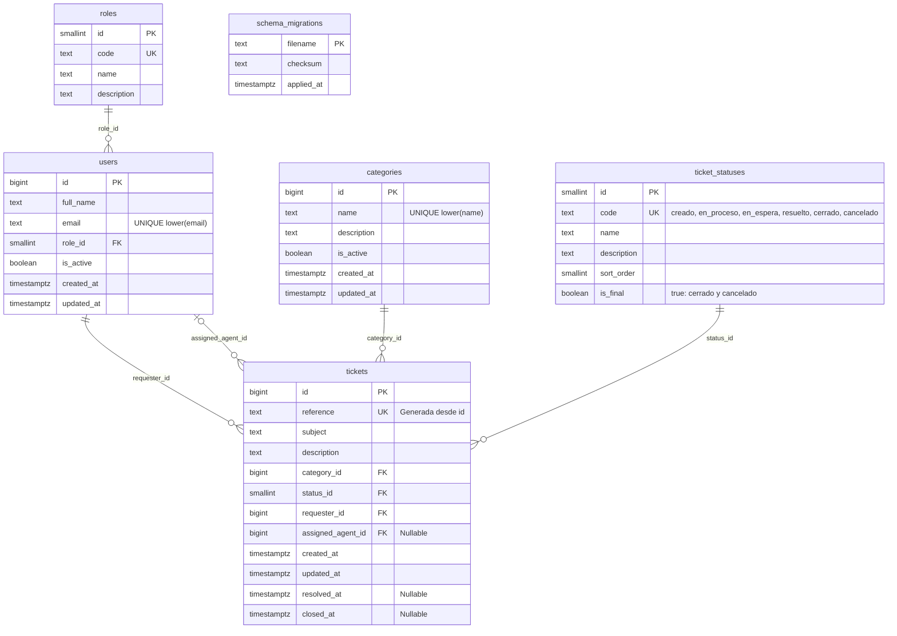

# Base de datos de HelpDesk

Esquema inicial del Sprint 0, PostgreSQL 17 y migraciones SQL sin ORM.
Los archivos en `migrations/` y `seeds/dev.sql` forman parte del repositorio;
el volumen del contenedor conserva los datos locales de cada desarrollador.

## Reconstruir el entorno

Desde `backend/`, con Node 22, npm y Podman Compose:

```bash
npm ci
cp -n .env.example .env
# Si acabas de crear .env, completa DATABASE_URL con las credenciales POSTGRES_*.
npm run db:up
npm run db:migrate
npm run db:status
```

`db:up` usa `podman compose up -d postgres`, identifica el contenedor mediante
Compose y consulta su healthcheck durante un máximo de 90 segundos. Devuelve
código 0 solo si llega a `healthy`; falla si Compose falla, el contenedor se
detiene, queda `unhealthy` o vence el plazo. Evita `--wait`: en podman-compose
1.6.0 ese flag delega en `podman wait`, que puede imprimir `-1` aun terminando
correctamente con código 0.

Los comandos SQL leen `DATABASE_URL` de las variables del proceso o del `.env`
del backend. No necesitan `psql` en el sistema. Los archivos SQL también se
encuentran al ejecutar la herramienta compilada: `node dist/db/cli.js migrate`.
Conserva la carpeta `db/` junto a `dist/` al distribuir el backend.

## Crear y aplicar una migración

```bash
npm run db:new -- agregar_campo
# Edita el archivo recién creado antes de aplicarlo; su número depende de los existentes.
npm run db:migrate
npm run db:status
```

`db:new` funciona sin conexión ni `.env`; usa el siguiente número disponible
de cuatro dígitos y normaliza el nombre a snake_case sin acentos.
Los archivos se ejecutan en orden alfabético y no pueden repetir su número.
Coordina la numeración con el equipo al combinar ramas.

- Una migración aplicada es **inmutable**: nunca la edites, renombres ni borres.
  Los cambios posteriores van en otro archivo numerado.
- `public.schema_migrations` registra nombre, SHA-256 de los bytes originales
  y fecha de aplicación. Un checksum distinto o un archivo aplicado ausente
  hacen fallar tanto `db:migrate` como `db:status` antes de aplicar cambios.
- Cada archivo y su registro se confirman en una misma transacción. Si falla,
  esa migración se revierte y la ejecución se detiene; las anteriores permanecen.
- No incluyas `BEGIN`, `COMMIT`, `ROLLBACK` ni operaciones incompatibles con
  transacciones, como `CREATE INDEX CONCURRENTLY`. El ejecutor controla la transacción.
- Un advisory lock de sesión compartido por migrate, status, reset y seed evita
  que estas herramientas se ejecuten simultáneamente contra la misma base.
- No modifiques manualmente `schema_migrations` para eludir una discrepancia.
  Restaura el archivo original desde Git y crea una migración nueva.
- Los compañeros pueden ajustar `core.autocrlf=false` en su copia de Git para
  conservar los finales de línea de los SQL: el checksum incluye esos bytes.

## Reset y datos de ejemplo

```bash
# DESTRUCTIVO: elimina todos los objetos y datos del esquema public local.
npm run db:reset
npm run db:seed:dev
# Repetir el seed no duplica los ejemplos.
npm run db:seed:dev
```

Ambos comandos se niegan a operar salvo con `NODE_ENV=development` (el valor
predeterminado) y host `localhost` o `127.0.0.1` en `DATABASE_URL`. Tampoco
admiten parámetros de URL que redirijan el host. No operan en producción ni
con `NODE_ENV=test`.

`db:reset` recrea `public` dentro de una transacción y después aplica las
migraciones, cada una en su propia transacción. No carga ejemplos; si una
migración falla después del reset, la base queda con las anteriores aplicadas.
La operación afecta a toda la base configurada: úsala solo en la base local
dedicada a HelpDesk. No borra el volumen ni otras bases del contenedor.

El seed es una transacción: inserta cuatro empleados `@helpdesk.local`, cinco
categorías y seis tickets, uno por estado. Usa `ON CONFLICT DO NOTHING`; para tickets
también comprueba asunto y solicitante antes de insertar, sin introducir una
restricción artificial sobre los asuntos de tickets reales. Los ejemplos
existentes no se sobrescriben. Las secuencias pueden tener saltos al repetir
inserciones con conflicto; las referencias no pretenden ser consecutivas.

## Decisiones del esquema

- `users` y `tickets` usan IDs bigint identity; los catálogos fijos `roles` y
  `ticket_statuses` usan smallint. `categories` usa bigint porque es configurable.
- Cada usuario tiene exactamente un `role_id` obligatorio. No hay `user_roles`
  ni contraseña. Los correos y nombres de categorías son únicos con índices
  sobre `lower(...)`, sin extensiones.
- Los cinco estados originales conservan sus IDs: 1 creado, 2 en_proceso,
  3 en_espera, 4 resuelto y 5 cerrado. Cancelado se incorpora mediante una
  migración nueva, con ID generado por identity y `sort_order = 6`.
  Identifica los estados por `code`; el valor predeterminado de
  `tickets.status_id` sigue siendo 1 (creado).
- `reference` es una columna generada almacenada y única: `TK-000001`,
  `TK-999999`, `TK-1000000`. Los números largos se conservan completos.
- `category_id`, `requester_id` y `status_id` son obligatorios;
  `assigned_agent_id`, `resolved_at` y `closed_at` admiten NULL.
- Las relaciones usan `ON DELETE RESTRICT`, sin cascadas. La aplicación usará
  `users.is_active` para desactivar empleados y no ofrecerá borrado físico de
  usuarios ni tickets. Las FK por sí solas no impiden borrar filas sin referencias;
  los permisos de escritura y esa política se definirán con la aplicación.
- Los únicos triggers actualizan `updated_at` en users, categories y tickets.
  La aplicación validará roles y transiciones, y escribirá las fechas de resolución
  y cierre. La base no obliga a pasar por estados intermedios.
- Las fechas son timestamptz; PostgreSQL conserva instantes y su presentación
  depende de la zona de la sesión. El ejecutor SQL usa UTC.

## Estados de tickets

| Orden | Código       | Nombre     | `is_final` |
| ----- | ------------ | ---------- | ---------- |
| 1     | `creado`     | Creado     | false      |
| 2     | `en_proceso` | En proceso | false      |
| 3     | `en_espera`  | En espera  | false      |
| 4     | `resuelto`   | Resuelto   | false      |
| 5     | `cerrado`    | Cerrado    | true       |
| 6     | `cancelado`  | Cancelado  | true       |

Cerrado significa que el problema se resolvió con éxito y el usuario confirmó
el cierre. Cancelado significa que se decidió no continuar, por ejemplo porque
el ticket se registró por error. Solo el supervisor podrá cancelar; esa regla
se implementará en la aplicación, sin restricciones de rol ni transiciones en
la base de datos.

El ejemplo cancelado conserva un agente asignado, pero `resolved_at` y
`closed_at` quedan en NULL: cancelar no representa una resolución exitosa ni
un cierre confirmado. No se agregan columnas ni triggers de negocio.

## Diagrama ER



## Inspección manual

```bash
podman exec backend_postgres_1 psql -U helpdesk -d helpdesk -c '\dt'
podman exec backend_postgres_1 psql -U helpdesk -d helpdesk -c '\d tickets'
podman exec backend_postgres_1 psql -U helpdesk -d helpdesk -c \
  'SELECT t.reference, t.subject, s.code AS status FROM tickets t JOIN ticket_statuses s ON s.id = t.status_id ORDER BY t.id'
curl -i http://localhost:3000/api/health/db
```

## Pruebas de las herramientas

```bash
npm run typecheck
npm run build
npm run test:db
# Con el seed cargado, las pruebas de restricciones se revierten al terminar:
podman exec -i backend_postgres_1 psql -U helpdesk -d helpdesk < test/schema.sql
```

Las pruebas de integración requieren PostgreSQL local y permiso `CREATEDB`.
Crean una base temporal aislada y la eliminan al terminar; no resetean HelpDesk.
Comprueban transacciones, inmutabilidad, exclusión mutua y protecciones locales.
