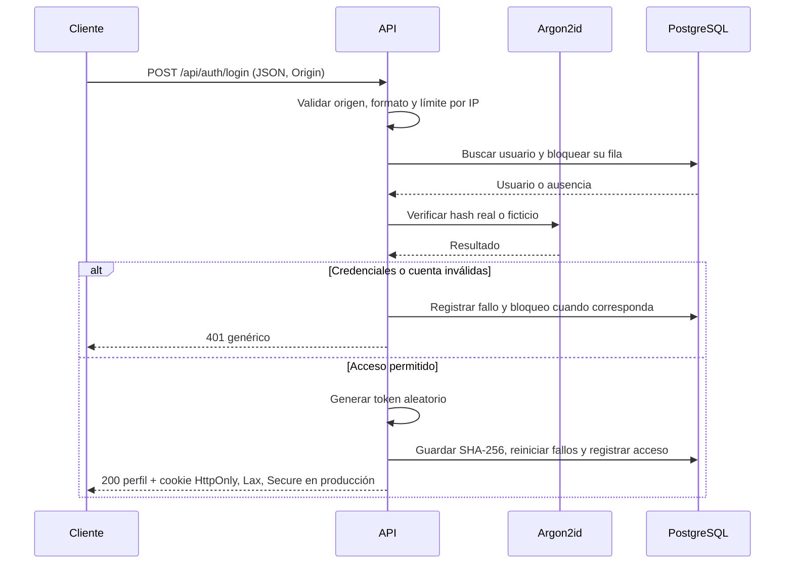

# Autenticación y sesiones

El HelpDesk es interno: cada empleado tiene un solo rol (`solicitante`, `agente`,
`supervisor` o `administrador`). No hay registro público. El acceso utiliza
contraseña y sesiones en PostgreSQL, sin JWT ni tokens en el almacenamiento del
navegador. La administración de cuentas llegará en otro cambio.

## Contraseñas y sesiones

Las contraseñas admiten de 10 a 128 caracteres Unicode y no pueden ser iguales
al correo, sin distinguir mayúsculas. Se permiten espacios y no se exigen reglas
de composición. Se usa Argon2id con 19 MiB de memoria, dos iteraciones y
paralelismo 1, el mínimo recomendado por
[OWASP](https://cheatsheetseries.owasp.org/cheatsheets/Password_Storage_Cheat_Sheet.html).
`@node-rs/argon2` utiliza binarios precompilados y genera una sal distinta por hash.
Ante un correo inexistente se verifica igualmente un hash ficticio generado al
arrancar, para evitar omitir el trabajo de Argon2id.

Cada sesión recibe 32 bytes aleatorios codificados en base64url. PostgreSQL
guarda solo su SHA-256. La cookie es `hd_session` en desarrollo y
`__Host-hd_session` en producción, siempre con `HttpOnly`, `SameSite=Lax` y
`Path=/`, sin `Domain`. En producción añade `Secure` y requiere HTTPS.
El cliente debe enviar las cookies (`credentials: 'include'` o equivalente).

Por defecto una sesión vence tras 30 minutos sin actividad o a las 8 horas de
crearse. `last_seen_at` se escribe como máximo una vez por minuto, por lo que la
medición de inactividad tiene esa granularidad. La actividad no extiende el límite
absoluto. Cada petición autenticada comprueba también revocación, usuario activo
y vencimiento de la cuenta; desactivar o vencer una cuenta invalida su acceso en
la siguiente petición. Los IDs bigint del perfil se devuelven como cadenas.

Las cuentas nuevas tienen `must_change_password = true`. Mientras sea así, solo
se permiten `GET /api/auth/me`, `POST /api/auth/logout` y
`POST /api/auth/change-password`; cualquier otra ruta de aplicación responde
403 `PASSWORD_CHANGE_REQUIRED`. Los GET públicos `/api/health` y
`/api/health/db` siguen disponibles. El administrador inicial y los usuarios
del seed eligen o reciben una contraseña de desarrollo y no requieren cambio.

## Protección de peticiones

Todos los POST, PUT, PATCH y DELETE requieren `Origin` igual a
`FRONTEND_ORIGIN`. Solo cuando falta ese encabezado se acepta el origen de
`Referer`; si falta también, se rechaza con 403 `CSRF_REJECTED`. El cuerpo debe
ser `application/json` (415 `JSON_REQUIRED` en caso contrario), incluido logout
con `{}`. La validación sucede antes de procesar las credenciales.
CORS permite credenciales exclusivamente al origen configurado.

Cinco fallos consecutivos bloquean la cuenta durante 15 minutos. Un acceso
correcto reinicia el contador; después del bloqueo vencido se inicia un nuevo
conteo. Las actualizaciones se serializan bloqueando la fila del usuario.
Además, hay un límite por IP de 30 solicitudes de login por cada 15 minutos,
con respuesta 429. Ese límite está en memoria por proceso; un despliegue con
varias instancias necesitará un almacén compartido. No se confía en cabeceras
de proxy salvo que se configure `TRUST_PROXY` para la topología real.

Los logs de rechazo contienen solo un motivo interno (`not_found`, `locked`,
`inactive`, `expired`, `password_unset` o `invalid_password`). Nunca contienen
correo, contraseña, hash, cookie, token ni cuerpo de la petición. Los errores
inesperados registran únicamente código y estado, sin el error original.

## Endpoints

Todos los errores tienen este formato; no incluyen stack traces:

```json
{ "error": { "code": "INVALID_CREDENTIALS", "message": "Credenciales incorrectas" } }
```

| Método y ruta                    | Entrada JSON                             | Respuesta                                                        |
| -------------------------------- | ---------------------------------------- | ---------------------------------------------------------------- |
| `POST /api/auth/login`           | `email`, `password`                      | 200, perfil y cookie de sesión                                   |
| `GET /api/auth/me`               | Sin cuerpo; cookie                       | 200, perfil; 401 sin sesión válida                               |
| `POST /api/auth/logout`          | `{}`; cookie opcional                    | 204; revoca la sesión y borra la cookie; idempotente             |
| `POST /api/auth/change-password` | `currentPassword`, `newPassword`; cookie | 200, perfil actualizado; conserva esta sesión y revoca las demás |

Perfil de ejemplo sin credenciales:

```json
{
  "id": "1",
  "fullName": "Empleado de ejemplo",
  "email": "empleado@helpdesk.local",
  "role": "solicitante",
  "mustChangePassword": false,
  "expiresAt": null
}
```

Login compara el correo sin distinguir mayúsculas. Un correo inexistente,
contraseña incorrecta, cuenta inactiva, vencida, bloqueada o sin contraseña
produce exactamente el mismo 401 `INVALID_CREDENTIALS`. Las entradas con
estructura inválida responden 400 `INVALID_INPUT`.
Change-password usa 401 para contraseña actual incorrecta, 400
`PASSWORD_POLICY` para una contraseña nueva inválida y 401
`AUTHENTICATION_REQUIRED` si la sesión ya no es válida. `requireRole(...)`
responde 403 `FORBIDDEN` cuando el rol no está permitido.
La nueva contraseña debe ser distinta de la actual: reenviar la temporal no
permite quitar la obligación de cambiarla.

### Probar con curl sin exponer credenciales

Desde `backend/`, con la API y la base migrada disponibles. Este ejemplo pide
la contraseña con entrada oculta y usa archivos privados para el JSON, las
cabeceras y las cookies; no imprime `Set-Cookie` ni guarda la contraseña en
argumentos o en el historial del shell. No actives `set -x` ni `curl -v`.

```bash
auth_tmp=$(mktemp -d)
chmod 700 "$auth_tmp"
AUTH_REQUEST_FILE="$auth_tmp/login.json" python3 - <<'PY'
import getpass
import json
import os

with open('/dev/tty', 'r+') as terminal:
    terminal.write('Correo: ')
    terminal.flush()
    email = terminal.readline().strip()
password = getpass.getpass('Contraseña: ')
with open(os.environ['AUTH_REQUEST_FILE'], 'w', encoding='utf-8') as request:
    os.chmod(request.name, 0o600)
    json.dump({'email': email, 'password': password}, request)
PY
curl -sS -D "$auth_tmp/headers" -c "$auth_tmp/cookies" \
  -H 'Origin: http://localhost:4200' -H 'Content-Type: application/json' \
  --data-binary @"$auth_tmp/login.json" http://localhost:3000/api/auth/login
curl -sS -b "$auth_tmp/cookies" http://localhost:3000/api/auth/me
curl -sS -b "$auth_tmp/cookies" -c "$auth_tmp/cookies" \
  -H 'Origin: http://localhost:4200' -H 'Content-Type: application/json' \
  --data '{}' -o /dev/null -w '%{http_code}\n' http://localhost:3000/api/auth/logout
curl -sS -b "$auth_tmp/cookies" http://localhost:3000/api/auth/me
rm -r -- "$auth_tmp"
```

El flujo esperado es 200, 200, 204 y 401. Ajusta el origen si lo cambiaste en
la configuración. Para cambiar contraseña, envía un JSON privado con las dos
propiedades indicadas en la tabla y la cookie actual. No copies cookies ni
contraseñas en reportes; al mostrar una cabecera, sustituye su valor por
`<oculto>` y conserva únicamente las banderas.

## Variables

Las variables habituales de PostgreSQL y `FRONTEND_ORIGIN` están en
`.env.example`. Estas opciones se validan al arrancar:

| Variable                  | Predeterminado  | Valores admitidos                                         |
| ------------------------- | --------------- | --------------------------------------------------------- |
| `SESSION_IDLE_MINUTES`    | 30              | Entero de 1 a 1440                                        |
| `SESSION_ABSOLUTE_HOURS`  | 8               | Entero de 1 a 168                                         |
| `LOGIN_MAX_ATTEMPTS`      | 5               | Entero de 1 a 100                                         |
| `LOGIN_LOCK_MINUTES`      | 15              | Entero de 1 a 1440                                        |
| `LOGIN_RATE_LIMIT_PER_IP` | 30              | Entero de 1 a 10000; ventana fija de 15 minutos           |
| `TRUST_PROXY`             | `false`         | `false` o número de saltos confiables de 0 a 10           |
| `SEED_DEV_PASSWORD`       | Aleatoria local | Solo seed de desarrollo; aplica la política de contraseña |

`TRUST_PROXY=true` se rechaza: no se debe confiar en cualquier cliente que
envíe `X-Forwarded-For`. Si se usa un número de saltos, el despliegue debe
garantizar que todos los caminos hacia la API atraviesan esos proxies.

## Operación

```bash
npm run db:up
npm run db:migrate
npm run user:create-admin
npm run dev
```

`user:create-admin` requiere una terminal interactiva, sin argumentos. Pide
correo, nombre y dos veces la contraseña con entrada oculta. Rechaza un correo
existente y crea al administrador con `must_change_password = false`.
No hay cuenta ni contraseña de administrador predefinida.

```bash
npm run db:seed:dev
npm run auth:purge-sessions
```

El seed conserva las protecciones de desarrollo y host local. Asigna contraseña
a los cuatro usuarios de ejemplo solo si no tienen hash. Puedes definir
`SEED_DEV_PASSWORD` en tu entorno local; si está vacía, el primer seed genera
una contraseña aleatoria en `backend/.seed-dev-password`, con permisos 600 e
ignorada por Git y Prettier. Esa es la opción predeterminada solo para
desarrollo: consulta el archivo localmente cuando necesites ingresar, sin
compartirlo ni copiarlo a documentación. Repetir el seed no restablece
contraseñas. Un reset elimina usuarios y sesiones; al volver a sembrar se usa
el valor configurado o el archivo local existente.

La purga elimina únicamente sesiones revocadas hace más de siete días o cuyo
límite absoluto o de inactividad venció hace más de siete días. No toca
usuarios ni sesiones todavía válidas. Ejecútala periódicamente mediante el
planificador del entorno; este cambio no instala un servicio ni un cron.

## Secuencia de inicio de sesión



## Pruebas y alcance

`npm run check` ejecuta lint, formato, tipos, Vitest y build. Sin
`DATABASE_URL` exportada, la integración se omite con un mensaje claro; las
unitarias siguen funcionando sin base, token de Telegram ni red externa.
Para ejecutar toda la integración local:

```bash
npm run db:up
npm run db:migrate
set -a
source .env
set +a
npm run check
```

Las pruebas crean usuarios con correos únicos y eliminan solo sus usuarios y
sesiones. Cubren cookies, hash del token, fallos y bloqueos, expiración,
revocación, contraseña temporal, cambio de contraseña, roles, CSRF y ausencia
de secretos en los logs.

Todavía no se incluyen frontend de acceso, administración de usuarios o
cuentas temporales, restablecimiento por administrador, recuperación por
correo, SSO, directorio corporativo, auditoría persistente EP-10 ni integración
de autenticación con Telegram. `expires_at` prepara el vencimiento de cuentas;
su interfaz de administración llegará después.
